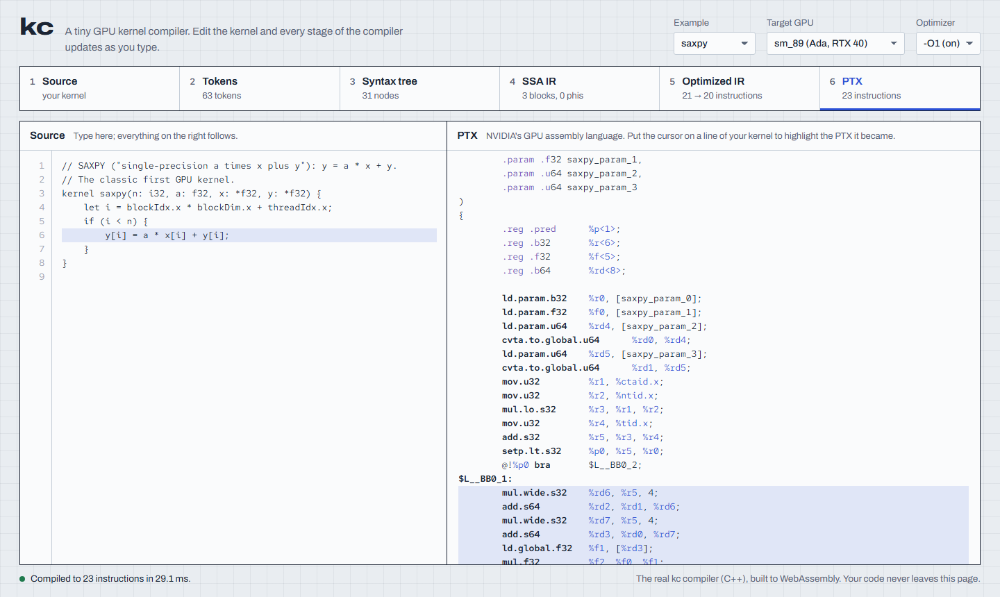
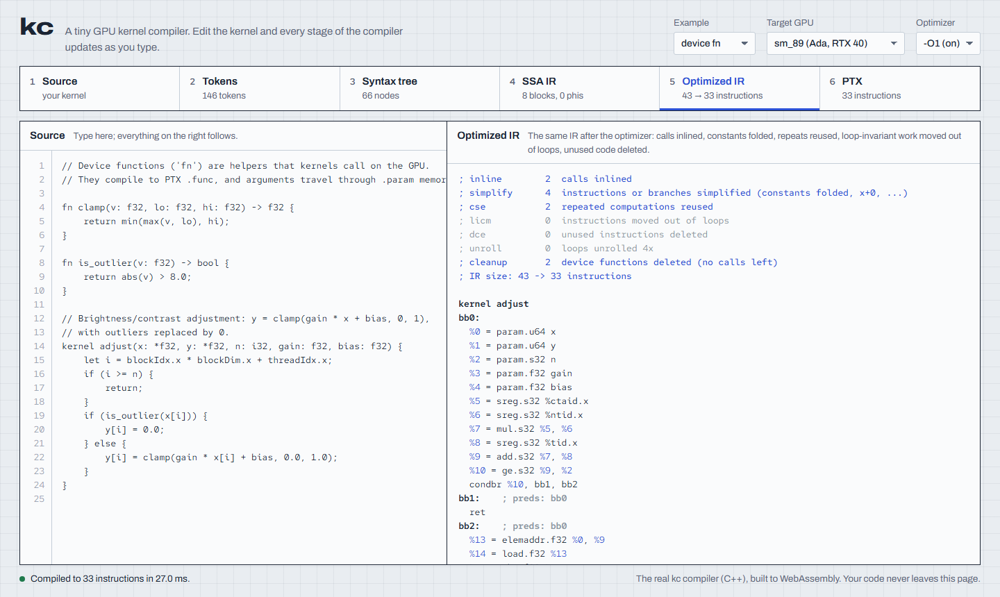
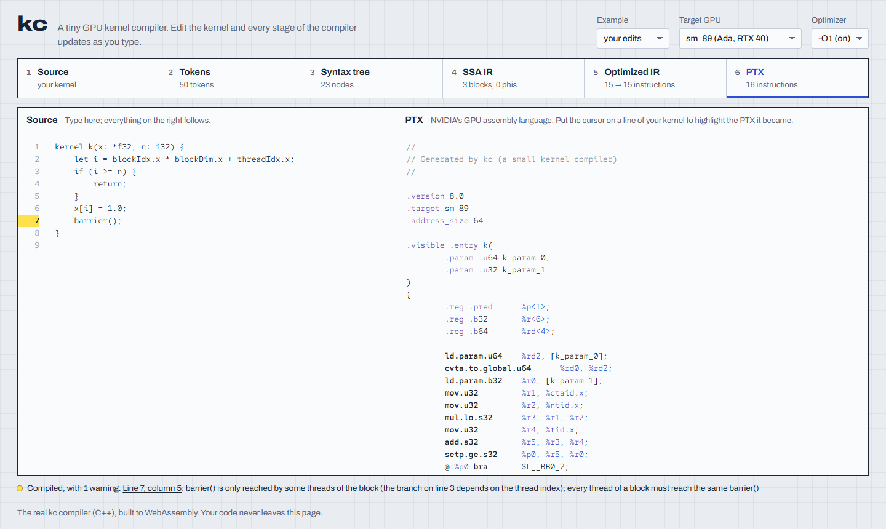

# kc: a small GPU kernel compiler that targets NVIDIA PTX

`kc` compiles a small CUDA-like language to **PTX**, NVIDIA's GPU assembly language,
and runs it on a real GPU through the CUDA Driver API. It is written from scratch in C++17:
no LLVM, no parser generators. On the kernels below it **matches nvcc's speed**. The same
compiler also runs in the browser (WebAssembly), in a playground that shows every stage live.

```
kernel warp_reduce(x: *i32, out: *i32, n: i32) {
    let i = blockIdx.x * blockDim.x + threadIdx.x;
    let v = 0;
    if (i < n) {
        v = x[i];
    }
    let total = warp_sum(v);      // redux.sync on sm_80+, 5 shuffles on older GPUs
    if (lane_id() == 0) {
        atomic_add(out[0], total);
    }
}
```

```
source ─▶ lexer ─▶ parser ─▶ type checker ─▶ SSA IR ─▶ divergence check ─▶ optimizer ─▶ PTX ─▶ ptxas ─▶ GPU
```

## kc vs nvcc

The same 7 kernels written in kc (`examples/`) and in CUDA C++ (`bench/kernels.cu`), both
compiled by the same ptxas (the PTX Compiler API), checked against the CPU, and timed on an
RTX 4060 Laptop GPU (`kc-bench`, milliseconds per launch, 16M elements):

| kernel | kc -O0 | kc -O1 | nvcc | kc -O1 / nvcc |
|---|---:|---:|---:|---:|
| saxpy | 0.92 | 0.93 | 0.92 | 1.01 |
| row_sum | 0.81 | 0.52 | 0.52 | 0.99 |
| matmul (512²) | 0.50 | 0.34 | 0.36 | 0.94 |
| block_sum (shared-memory reduction) | 0.66 | 0.56 | 0.56 | 1.00 |
| warp_reduce | 0.28 | 0.28 | 0.29 | 0.99 |
| histogram (atomics) | 1.42 | 1.42 | 1.42 | 1.00 |
| adjust (device functions) | 0.58 | 0.60 | 0.59 | 1.00 |

Getting there meant finding what ptxas does *not* do, by reading the SASS. ptxas already does
CSE, loop-invariant code motion and constant folding (kc's versions of those left the SASS
byte-identical). But it leaves three things to the front end, as nvcc's NVVM stage does:

- **inlining**: ptxas keeps real `CALL`s (device_fn: 36 SASS instructions with 2 calls → 19)
- **loop unrolling**: ptxas keeps one load per iteration (row_sum 0.82 → 0.52 ms)
- **division by a constant**: ptxas emits a ~20-instruction division routine even for `/ 2`
  (block_sum 0.64 → 0.56 ms)

The full write-up, with the method and charts, is the technical report: [`docs/report.pdf`](docs/report.pdf).

## Playground

The same compiler, built to WebAssembly, runs in the browser (`web/index.html`, no server).
Every stage updates as you type: tokens, syntax tree, SSA IR, optimized IR (with what each pass
changed) and PTX.


*The cursor's source line highlights the PTX it became (from the `.loc` line info).*


*Stage 5: both device functions inlined and deleted, with the report of what each pass did.*


*The divergence analysis warns about a `barrier()` that threads past the early `return` never reach.*

## What's inside

**Language:** kernels and device functions (with recursion), `i32` / `f32` / `bool` and
pointers, shared memory + `barrier()`, `atomic_add`, warp operations (`warp_sum`, `shfl_down`,
`shfl_xor`, `ballot`, `lane_id`), `if` / `while` / `for` / `break` / `continue`, short-circuit
`&&` / `||`, and `sqrt` / `abs` / `min` / `max` / `popc`.

**Compiler:** hand-written lexer and recursive-descent parser, a strict type checker with
line:column errors, SSA IR built directly from the syntax tree (Braun et al. 2013), and a PTX
backend: phi elimination, the `.param` calling convention, constants as immediates, and
per-architecture lowering (`warp_sum` is `redux.sync` on sm_80+ and shuffles before).

**Analyses:** dominators and post-dominators (Cooper-Harvey-Kennedy), natural loops, and a
divergence analysis that warns when `barrier()` or a warp operation is reached by only some
threads (e.g. after an early `return`), and marks uniform branches `bra.uni`.

**Optimizer (`-O1`):** inlining, constant folding (bit-exact with the GPU), division by powers
of two as shifts, CSE over the dominator tree, loop-invariant code motion, dead code
elimination and 4x loop unrolling, with an IR verifier after every pass.

**Debug info, linking, object files:** `-lineinfo` writes `.loc` line info, so
`nvdisasm` and compute-sanitizer name kc source lines (an out-of-bounds write is reported
"in oob.kc:5"). `export fn` / `extern fn` give separate compilation, linked with **nvJitLink**
(`kc-link`). `cubin-info` reads a cubin's ELF sections, symbols, register counts and
relocations, and shows the cost of separate compilation (24 registers instead of 10, no inlining).

**Testing:** 33 end-to-end tests run on the GPU at both `-O0` and `-O1` and compare every
result with a CPU reference (warp operations are tested for both sm_89 and sm_75 code);
examples are checked with `ptxas` and `cubin-info`; random program testing (`kc-fuzz`) checks that
`-O0` and `-O1` agree on random kernels; compute-sanitizer memcheck and racecheck are clean.

**A ptxas bug, found by the random tester:** across 2,050 random programs, kc-fuzz found no kc
bugs, but one mismatch shrank to six PTX instructions (`abs`, `neg`, `setp.ge ..., -5`) that
ptxas `-O3` folds to "always false" on sm_75 through sm_90 (`-O0` is correct). nvcc never emits
that pattern, because its front end rewrites the comparison first. Reproducer:
[`tests/ptx/ptxas_neg_abs.ptx`](tests/ptx/ptxas_neg_abs.ptx); details in the report.

## Build and test (WSL2 / Linux, CUDA 12+)

```bash
bash test.sh            # builds, runs the GPU tests, checks PTX with ptxas, runs compute-sanitizer
~/kc-build/kc-bench     # kc vs nvcc on the GPU
~/kc-build/kc examples/saxpy.kc -o -                         # print the PTX
~/kc-build/kc examples/relu.kc --emit-ir -o -                # print the SSA IR too
~/kc-build/kc examples/device_fn.kc --passes -o /dev/null    # what each optimizer pass changed
~/kc-build/kc examples/warp_reduce.kc --arch sm_75 -o -      # warp_sum as shuffles for older GPUs
python3 tools/measure.py                                     # PTX / SASS sizes, -O0 vs -O1 vs nvcc
~/kc-build/kc examples/relu.kc -lineinfo -o relu.ptx         # PTX with source line info
~/kc-build/kc-link lib.ptx main.ptx -o program.cubin         # link separately compiled files
~/kc-build/cubin-info program.cubin                          # what is inside a cubin
bash web/build.sh       # rebuild the playground (needs Emscripten), then open web/index.html
```
